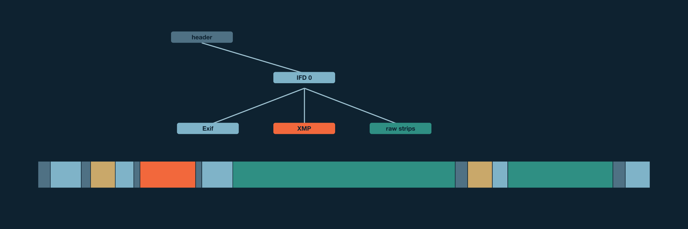

This post is by Alexy Khrabrov, with Claude as co-author. The ideas are Alexy's; Claude wrote the text and the code with him.

When you give a photo a star rating in Lightroom, the rating has to be stored somewhere. For a DNG it can be written into the file itself, in a block of XML called the XMP packet. Change one keyword and the packet changes, and nothing else in the file should.

That "nothing else" is harder to promise than it sounds. A DNG is a TIFF file: a header and a graph of directories whose entries point at values, at other directories and at image data scattered through the file. Most programs that read TIFF understand most files. That is fine for showing a picture. It is not fine for rewriting part of a file in place, because the files a reader half understands are exactly the ones where an unknown field might hold an offset into the packet. Rewrite the packet, and you corrupt bytes you never saw.

[tiffgraph](https://github.com/firstpair/tiffgraph) is a small OCaml library built for that one question. Give it a file and a grammar, and it either returns the exact extent of the XMP packet, having checked that every other extent the file declares lies outside it, or refuses the file and says why. It never guesses.

```ocaml
match Tiffgraph.walk (Tiffgraph.v1 ~max_xmp:(1 lsl 20)) reader with
| Ok (Some { Tiffgraph.offset; length }) -> (* rewrite only these bytes *) ()
| Ok None -> ()
| Error reason -> prerr_endline ("refused: " ^ reason)
```



## Grammars, not heuristics

The grammar decides what a file may contain. There are four, each a superset of the one before:

- **`v0`** admits classic TIFF with a fixed list of standard fields, and one packet.
- **`v1`** adds BigTIFF, embedded camera profiles, and the DNG 1.7 JPEG XL fields.
- **`merge_only`** adds the private fields camera converters write, such as MakerNotes and DNGPrivateData. It keeps their bytes exactly as they are and never interprets them.
- **`layout`** accepts any field and keeps it byte-exact, for describing a file's geometry, not for editing it.

Anything outside the grammar is a refusal with a reason, such as `unsupported TIFF tag 34859`. If you have checked a field yourself, you can admit it at run time. Every walk is bounded, whatever the file claims: 256 directories, 16,384 entries, and so on. A cycle, an extent past the end of the file, or a strip that overlaps the packet ends the walk.

On the 60 catalog DNGs we tried, all but three needed `merge_only`. Those three carry no embedded packet at all. Real camera files are messier than the standard, and a refusal tells you exactly how.

## An identity that ignores the metadata

Once you can trust where the packet is, you can hash everything except it. Two files with the same **preserved digest** differ, if at all, only in their metadata. That is the question a backup or a synchronizer needs answered: is this the same photograph with different keywords, or a different photograph?

tiffgraph computes no hashes, by design. Two other projects compute this digest over its regions, one in OCaml and one in Rust. [Semantic Unison](https://firstpair.org/books/semantic-unison/), a fork of the Unison file synchronizer, uses it to merge metadata edits made on two machines. [phidentify](https://github.com/firstpair/phidentify), a library of named identities for photo files, records it in a backup index. When we compared the two implementations on those 60 DNGs, every digest agreed byte for byte.

## Small, and tested on bytes that never existed

tiffgraph started life as a module inside Semantic Unison. It became its own package so that other projects could use it without the synchronizer. Its OCaml build is one file with no dependencies. It builds with stock OCaml 5 and with OxCaml, where its interface is portable, so walks can run in parallel domains.

It also has a Rust build, just in case: a crate with no dependencies, a line-for-line port with the same grammars, the same limits and the same refusal reasons. Two builds of one checker are only safe if they agree, so a test runs both on every file and compares what every grammar makes of it, down to the last component region. The files are 40 synthetic DNGs, 3,000 random mutations of them, and the 328 real DNGs we had at hand. They agreed on every one. When we changed one detail in the Rust build to see whether the comparison would notice, it failed at once.

Its tests use no photographs. A small TIFF writer in the test suite builds every case in memory: both byte orders, classic and BigTIFF, each grammar's acceptances and refusals, cycles, overlaps, admissions. That makes 47 controls in OCaml, and the Rust build has its own, including the limits no ordinary file reaches. They do catch breakage: disable the overlap check, and exactly the overlap test fails.

The [manual](https://firstpair.org/books/tiffgraph/) has the rest: the reader contract in both languages, every grammar in detail, the limits, the region roles, how the two builds are kept in step, and the digest's exact definition. tiffgraph is MIT-licensed, at [github.com/firstpair/tiffgraph](https://github.com/firstpair/tiffgraph).
