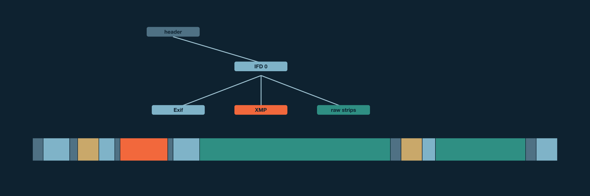

# About this manual

This manual is by Alexy Khrabrov, with Claude as co-author. The ideas and decisions are Alexy's; Claude wrote the text and the code with him.

It describes tiffgraph 0.1.0 as of 2026-11-02. tiffgraph is licensed under the MIT License. Its source is at [github.com/firstpair/tiffgraph](https://github.com/firstpair/tiffgraph).

# What tiffgraph is

A DNG file is a TIFF file: a header, then a graph of directories (IFDs) whose entries point at values, at other directories and at image data scattered through the file. Somewhere in that graph is usually one XMP packet: the text where Lightroom and other editors write keywords, ratings and develop settings.

Editing a photo's metadata in place means rewriting that packet and nothing else. To do that safely you need to know two things for certain: where the packet is, and that no other part of the file lives inside it. A TIFF reader that understands most files is not enough for that, because the files it half understands are the dangerous ones. A private field may hold an offset that points into the packet, and rewriting the packet would then corrupt something you never saw.

tiffgraph is a walker built for that question. Given a file and a **grammar**, it does one of two things:

- **It accepts the file.** It returns the exact extent of the primary XMP packet, having checked that every other extent the file declares lies outside it.
- **It refuses the file**, with a reason: an unknown field, a cycle, an extent past the end, an overlap, a limit reached.

It never guesses. A field outside the grammar is a refusal, not something to skip.

It can also report the file's **physical regions**, from the header to the last byte of image data, each with a role. That is useful for deduplication, for diffing two versions of a file, and for computing identities over parts of a file.



## Where it fits

This book is one of nine on the FirstPair photo tools. Each owns one part, and
[The FirstPair Photo Stack](https://firstpair.org/books/photostack/) shows how they fit together.

- **[tiffgraph](https://firstpair.org/books/tiffgraph/)** walks a TIFF or DNG file's structure under a fixed grammar and finds its editable XMP packet.
- **[phidentify](https://firstpair.org/books/phidentify/)** computes a photo's identities: SHA-256, DNG raw blocks, image data, Lightroom fingerprint, metadata record and preserved digest.
- **[phindex](https://firstpair.org/books/phindex/)** keeps those identities for every file of a volume, and aligns two volumes by content.
- **[DNG Compare](https://firstpair.org/books/dng-compare/)** compares pairs and preserves one side byte for byte as deltas against the other, with a searchable metadata section, through `dngc`.
- **[Semantic Unison](https://firstpair.org/books/semantic-unison/)** synchronizes photo trees, sending metadata edits without resending image bytes, and preserves what a shuttle disk brings into the same archives.
- **[packdir](https://firstpair.org/books/packdir/)** keeps directories of small files as SQLite archives that still work like plain files.
- **[Tursolite](https://firstpair.org/books/tursolite/)** is the SQLite and Turso layer under packdir, DNG Compare and Mechanic.
- **[diskproxy](https://firstpair.org/books/diskproxy/)** serves a folder as a virtual disk, such as previews with camera metadata spliced in, and captures ratings into sidecars.
- **[Lightroom Repair](https://firstpair.org/books/lightroom-repair/)** repairs Lightroom Classic catalogs, previews and Sync without forging their state.

## What it is not

- **Not a validator.** An accepted file has a well-formed graph under the grammar. Nothing more is checked about whether it is a correct DNG.
- **Not a decoder.** It never reads pixel data, only where pixel data is.
- **Not an identity.** It computes no hash. A caller that rewrites the packet must still prove separately that every byte outside it stayed the same. The section on the preserved digest shows how two projects do that.

## Where it comes from

tiffgraph began as the `DngSemantic` module of Semantic Unison, a fork of the Unison file synchronizer that can merge metadata edits to the same photo made on two machines. The grammars are the ones Semantic Unison negotiates between peers as its `org.firstpair.dng-xmp/0`, `/1` and `/2` profiles. It became its own package on 2026-11-02, so that other projects could use it without Unison. One of them is phidentify, a library of named identities for photo files.

The code moved without change. The old and new walkers gave byte-identical results on 328 local DNGs, and Unison's own DNG tests pass against the package.

The same day it gained a second build, in Rust: a line-for-line port with the same grammars, limits, order of checks and refusal reasons. The two builds are compared file by file, as the chapter on Rust describes.

# Installing

## OCaml and OxCaml

The OCaml build has no dependencies beyond the standard library. It builds with stock OCaml 5.1 or later and with OxCaml.

```sh
opam pin add tiffgraph git+https://github.com/firstpair/tiffgraph.git#main
```

Use it from dune:

```lisp
(executable
 (name scan)
 (libraries tiffgraph))
```

or from a plain compiler command, since opam installs it beside the standard library:

```sh
ocamlfind ocamlopt -package tiffgraph -linkpkg scan.ml -o scan
ocamlopt -I +../tiffgraph tiffgraph.cmxa scan.ml -o scan
```

## Rust

The Rust build is the crate in `rust/`, also with no dependencies:

```toml
[dependencies]
tiffgraph = { git = "https://github.com/firstpair/tiffgraph" }
```

It uses Rust edition 2024; the repository pins the toolchain in `rust/rust-toolchain.toml`.

# Using it

## The reader

tiffgraph never opens files. You give it a **reader**: three functions over whatever holds the bytes.

```ocaml
type reader = {
  size : int64;
  read : int64 -> int -> string;
  check : unit -> unit;
}
```

- **`size`** is the file's length. Every extent is checked against it.
- **`read offset length`** returns exactly `length` bytes or raises.
- **`check`** runs once, after a walk that succeeds. Use it to confirm the file did not change while it was read, for example by comparing its modification time and size with what they were at the start.

Exceptions from `read` and `check` pass through `walk` unchanged, so your own error type survives. Only the walker's own refusals become `Error`.

A reader over a file descriptor:

```ocaml
let reader_of_fd fd =
  let size = (Unix.LargeFile.fstat fd).st_size in
  let read offset length =
    let buf = Bytes.create length in
    ignore (Unix.LargeFile.lseek fd offset Unix.SEEK_SET);
    let rec fill at =
      if at < length then
        match Unix.read fd buf at (length - at) with
        | 0 -> failwith "short read"
        | n -> fill (at + n) in
    fill 0;
    Bytes.unsafe_to_string buf in
  { Tiffgraph.size; read; check = (fun () -> ()) }
```

A reader over a string held in memory is even shorter, and the test suite uses one.

## Finding the packet

```ocaml
match Tiffgraph.walk (Tiffgraph.v1 ~max_xmp:(1 lsl 20)) reader with
| Ok (Some { Tiffgraph.offset; length }) ->
    Printf.printf "XMP at %Ld, %d bytes\n" offset length
| Ok None -> print_endline "no packet, and the policy did not require one"
| Error reason -> print_endline ("refused: " ^ reason)
```

`max_xmp` is the largest packet you will accept; Semantic Unison uses 1 MiB. `Ok None` happens only with a policy whose `require_xmp` is false.

To find the strictest grammar a file satisfies, try them in order:

```ocaml
let strictest reader =
  List.find_map (fun (name, policy) ->
    match Tiffgraph.walk (policy ~max_xmp:(1 lsl 20)) reader with
    | Ok (Some packet) -> Some (name, packet)
    | _ -> None)
    [ "v0", Tiffgraph.v0; "v1", Tiffgraph.v1; "merge_only", Tiffgraph.merge_only ]
```

# The grammars

A grammar fixes which directories, fields and field types a file may contain. Each is a superset of the one before.

| Policy | Admits | Semantic Unison profile |
| --- | --- | --- |
| `v0` | Classic TIFF in either byte order. Image, Exif, GPS and Interop directories, and SubIFDs, with a fixed set of standard fields. One XMP packet of type BYTE in the primary directory. | `dng-xmp/0` |
| `v1` | `v0`, plus BigTIFF, embedded camera profiles, and the DNG 1.7 JPEG XL scalars. | `dng-xmp/1` |
| `merge_only` | `v1`, plus fields camera converters write that hold private bytes. All are kept as protected values; none is interpreted. | `dng-xmp/2` |
| `layout` | `v1` geometry with any field accepted and kept byte-exact. | `dng-layout/0` |

## v0

Every file must start with `II` or `MM` and the TIFF magic 42. The primary directory must carry a DNGVersion of 1.0 to 1.7. Strips, tiles and the JPEG interchange format are followed through their offset and count pairs, and each piece is protected. The XMP packet (tag 700) must be type BYTE, longer than an inline value, and no longer than `max_xmp`.

Only listed standard fields are allowed in each directory. A field that might hold an offset, such as an unknown LONG or a MakerNote, is refused, because it could point into the packet.

## v1

`v1` adds BigTIFF (magic 43, with eight-byte offsets) and camera profiles. A camera profile is a small TIFF of its own, magic `CR`, pointed to from the primary directory's ExtraCameraProfiles field (tag 50933). Its offsets are relative to its own start. tiffgraph follows each one, checks that it has a single directory and only profile fields of the right types, and protects it. `v1` also accepts the DNG 1.7 scalars ColumnInterleaveFactor, JXLDistance, JXLEffort and JXLDecodeSpeed.

## merge_only

Many DNGs made by camera converters carry fields `v1` refuses. `merge_only` accepts them as protected values that may not change and may not overlap the packet:

- An Exif MakerNote (37500), UNDEFINED or BYTE.
- DNGPrivateData (50740), BYTE, in the primary directory only.
- ImageNumber (37393) and CacheVersion (51114), each a single LONG.
- ProfileGainTableMap (52525) and tag 52545, UNDEFINED.
- A 4-byte TIFF/EP StandardID (37398), and Exif CompositeImageExposureTimes (42082).
- Any field of a simple type (ASCII, SHORT, RATIONAL, SSHORT, SRATIONAL, FLOAT or DOUBLE) outside camera profiles, since such types hold only numbers and text.
- Fields named at run time with `admit_fields`.
- XMP packets of sub-images, such as iPhone portrait mattes. Only the primary directory's packet is located; the others are protected like any value.
- A primary packet of type UNDEFINED, as Lightroom mobile writes it.

None of the private bytes are interpreted, including DNGPrivateData's own offset. They stay exactly as they are.

## layout

`layout` accepts any field and protects its value byte-exact, without interpreting it. It describes a file's geometry, and `component_regions` uses it. It grants no right to edit anything, because a field it does not understand might still hold a hidden pointer.

## Admissions

`admit_fields` widens `merge_only` at run time with fields you have checked yourself:

```ocaml
match Tiffgraph.parse_admission "Image:65001:4" with
| Ok field -> Tiffgraph.admit_fields [field]
| Error reason -> prerr_endline reason
```

An admission names a directory (`Image`, `Exif`, `GPS` or `Interop`), a tag and a type. Pointer types are refused, and camera-profile fields cannot be admitted. `admit_fields` replaces the whole list, so `admit_fields []` withdraws them all. The list is held in an `Atomic.t`, so domains running walks see one list or the other, never a mixture.

To find out what a file needs, `unknown_fields` lists every field outside `merge_only` instead of stopping at the first:

```ocaml
let fields, stopped = Tiffgraph.unknown_fields ~max_xmp:(1 lsl 20) reader in
List.iter (fun (directory, tag, typ, count) ->
  Printf.printf "%s:%d:%d (count %Ld)\n" directory tag typ count) fields
```

It is a survey, not a verdict. A noted field is then walked as a plain value, so what follows it is advisory.

# Limits

Every walk is bounded, whatever the file claims:

| Limit | Value |
| --- | --- |
| Directories, visited and queued | 256 |
| Entries over all directories | 16,384 |
| Protected extents | 131,072 |
| Pieces in one strip or tile list | 65,536 |
| Pointers in one SubIFD or camera-profile list | 256 |
| Component regions | 65,536 |
| XMP packet | `max_xmp` |

A directory reached twice is a refusal, so a cycle cannot loop. Every offset and length is checked against `size` before it is read, and unsigned 64-bit values too large for a signed `int64` are refused rather than wrapped.

# Component regions

`component_regions` walks with the `layout` grammar, requires no packet, and returns every physical claim in the file:

```ocaml
match Tiffgraph.component_regions ~max_xmp:(1 lsl 20) reader with
| Ok regions ->
    List.iter (fun (r : Tiffgraph.component_region) ->
      Printf.printf "%-40s %Ld+%Ld\n" r.logical_id r.offset r.length) regions
| Error reason -> prerr_endline reason
```

Each region has a role:

| Role | What it is |
| --- | --- |
| `Structure` | The header, directory counts, entry descriptors, out-of-line offsets, inline padding, next-directory links, camera-profile headers. |
| `Standard_value` | The value of a field the grammar knows. |
| `Private_value` | The value of any other field. |
| `Image_bytes` | A strip or tile of an image in an Image directory. |

Logical IDs such as `ifd/0/tag/700/value` or `ifd/1/image/273/0` name a region by the order the walk visited it. They identify places in the graph, not decoded pixels. Regions may alias: two fields may point at the same bytes. A consumer that treats regions as independent parts must refuse files where claims conflict.

# OxCaml

Under OxCaml, tiffgraph's interface is `@@ portable`, generated at build time when the compiler version contains `+ox`. Its functions can be called from `Domain.Safe.spawn` workers.

The reader's functions do not have to be portable to pass them to `walk`. Portability matters only for what the closure you give to `Domain.Safe.spawn` captures. Build the reader inside the worker, for example from a portable `pread` external on a file descriptor, and nothing non-portable crosses domains. phidentify's backup indexer does exactly that.

# Rust

The Rust build has the same parts under Rust names:

```rust
use tiffgraph::{walk, FileReader, Observers, Policy, WalkError};

let mut reader = FileReader::open(path)?;
match walk(&Policy::v1(1 << 20), &mut reader, Observers::default()) {
    Ok(Some(xmp)) => println!("XMP at {}, {} bytes", xmp.offset, xmp.length),
    Ok(None) => println!("no packet, and the policy did not require one"),
    Err(WalkError::Refused(reason)) => println!("refused: {reason}"),
    Err(WalkError::Reader(e)) => return Err(e.into()),
}
```

- **The reader is a trait**, `Reader`, with `size`, `read` and a `check` that does nothing unless you supply one. `SliceReader` reads bytes in memory and `FileReader` reads a file with positional reads.
- **Errors are typed.** A refusal is `WalkError::Refused(reason)`, with the same reason text as the OCaml build. A reader failure is `WalkError::Reader(e)`, with the reader's own error unchanged.
- **Observers are optional closures.** `Observers { record, unknown }` takes the place of OCaml's `?record` and `?unknown`. A `record` closure may return `Err` to stop the walk, which is how `component_regions` enforces its limit.
- **Policies are constructors:** `Policy::v0(max_xmp)`, `v1`, `merge_only` and `layout`.
- **Admissions are global**, as in OCaml: `admit_fields` replaces the list behind a lock and `parse_admission` parses `Image:65001:4`. It accepts integers in the same forms OCaml's `int_of_string` does, so `Exif:0x927c:7` means the same in both.

## One behaviour, two builds

A port is only as good as its comparison, so the two builds are compared on every file, by `test/cross.py` (`make cross`). Each build has a small `dump` program that prints what every grammar makes of a file: the packet or the exact refusal reason under `v0`, `v1`, `merge_only` and `layout`, the unknown-field survey, and every component region with its ID, schema, role, offset and length. The two outputs must be identical, byte for byte. The files are:

- **40 synthetic DNG-shaped files:** both byte orders, classic TIFF and BigTIFF, sub-IFDs, Exif, a camera profile, private fields, UNDEFINED packets, JPEG XL scalars.
- **3,000 seeded mutations of them:** bytes flipped, files cut short, counts and offsets overwritten, stretches duplicated. Most are refused, and the point is that both builds refuse them for the same reason.
- **Any files you add,** such as real DNGs. On 2026-11-02 the 328 local DNGs gave identical output from both builds.

The comparison does catch differences. Changing the role of strip regions in the Rust build made it fail at once, naming the first line that differed. It can't catch differences in limits that no compared file reaches, so the Rust tests check those directly: more than 65,536 strip pieces, more than 16,384 entries, and an eight-byte number past signed 64 bits.

# The preserved digest

A walker that finds the packet makes possible an identity that ignores it: a hash of every byte **outside** the editable region, with the layout bound in. Two files with the same preserved digest under the same grammar differ, if at all, only inside their XMP packets.

Semantic Unison calls it `SDE/0-preserved`. Its definition, with every integer an unsigned 64-bit big-endian number:

```text
SHA-256( "SDE/0-preserved\0"
       ‖ file size
       ‖ number of regions
       ‖ (offset ‖ length) for each region
       ‖ (start ‖ length ‖ bytes) for each gap before, between and after the regions )
```

The regions are what `walk` returns: the one XMP packet. Gaps are hashed even when empty, so the packet's position is always bound in. The digest depends on the grammar only through the regions, so compare digests only between files accepted by the same grammar.

tiffgraph computes no hashes, by design. Semantic Unison computes this digest in OCaml, and phidentify in Rust, both over regions from tiffgraph. On 2026-11-02 they were compared on 60 randomly chosen catalog DNGs: all 57 files with a packet gave the same strictest grammar (`merge_only`) and the same digest from both, and the 3 without a packet were refused by both.

# Testing

```sh
make both                 # OCaml tests, stock OCaml 5 and OxCaml
make rust                 # Rust tests and clippy
make cross                # the two builds agree on every file
make all                  # all three
```

The tests build every file in memory from a list of TIFF entries, so the repository holds no photos and no fixtures. The OCaml build has 47 controls:

- **Shapes:** minimal DNGs in both byte orders, classic TIFF and BigTIFF, accepted by each grammar that should accept them.
- **Refusals:** a missing or unsupported DNGVersion, duplicate tags, a cyclic pointer, unpaired strips, two packets, a value past the end, a strip inside the packet, a packet over `max_xmp`, unknown fields per grammar.
- **Widening:** UNDEFINED packets, simple types, MakerNote, DNGPrivateData placement, admissions and their withdrawal.
- **Reader contract:** `check` runs once after success and never after a refusal; reader exceptions pass through.
- **Regions:** roles of the header, strips, standard and private values, all inside the file.

The tests do catch breakage. With the overlap check disabled, exactly the strip-inside-the-packet control fails.

The Rust build has the same kinds of control in five groups (shapes, refusals, widening and admissions, regions and the reader contract, and limits), built with its own small TIFF writer. Then the cross check compares the two builds.

## Changing a grammar

The grammars are a protocol: Semantic Unison peers agree on them by name. Widening one changes what peers will accept, so a change needs agreement with Semantic Unison first, the same change in both builds, and synthetic controls for every new acceptance and every refusal next to it. `make all` must pass before it is published.

# Reference

## OCaml

```ocaml
type reader = { size : int64; read : int64 -> int -> string; check : unit -> unit }
type xmp = { offset : int64; length : int }
type component_role = Image_bytes | Standard_value | Private_value | Structure
type component_region = { logical_id : string; schema : string; role : component_role;
                          offset : int64; length : int64 }
type policy = { extended : bool; opaque_maker : bool; layout_only : bool;
                require_xmp : bool; max_xmp : int }

val v0 : max_xmp:int -> policy
val v1 : max_xmp:int -> policy
val merge_only : max_xmp:int -> policy
val layout : max_xmp:int -> policy

val walk : ?record:(component_region -> unit) ->
  ?unknown:(string -> int -> int -> int64 -> unit) ->
  policy -> reader -> (xmp option, string) result

val admit_fields : (string * int * int) list -> unit
val parse_admission : string -> (string * int * int, string) result
val unknown_fields : max_xmp:int -> reader -> (string * int * int * int64) list * string option
val component_regions : max_xmp:int -> reader -> (component_region list, string) result
```

`walk`'s `record` sees each region as it is found, and `unknown` turns an unknown field from a refusal into a note. `schema` on a region says how to read its bytes: `tiff-structure/0`, `tiff-encoded-unit/0`, or `tiff-value/0:<byte order>:<type>:<count>`.

## Rust

```rust
pub trait Reader {
    type Error;
    fn size(&self) -> i64;
    fn read(&mut self, offset: i64, length: usize) -> Result<Vec<u8>, Self::Error>;
    fn check(&mut self) -> Result<(), Self::Error> { Ok(()) }
}
pub struct SliceReader<'a>(pub &'a [u8]);
pub struct FileReader { /* ... */ }            // FileReader::open(path)

pub struct Xmp { pub offset: i64, pub length: usize }
pub enum ComponentRole { ImageBytes, StandardValue, PrivateValue, Structure }
pub struct ComponentRegion { pub logical_id: String, pub schema: String,
                             pub role: ComponentRole, pub offset: i64, pub length: i64 }
pub struct Policy { pub extended: bool, pub opaque_maker: bool, pub layout_only: bool,
                    pub require_xmp: bool, pub max_xmp: usize }
pub enum WalkError<E> { Refused(String), Reader(E) }
pub struct Observers<'a> { pub record: Option<RecordFn<'a>>, pub unknown: Option<UnknownFn<'a>> }

impl Policy { pub fn v0(max_xmp: usize) -> Policy; /* v1, merge_only, layout */ }
pub fn walk<R: Reader>(policy: &Policy, reader: &mut R, obs: Observers<'_>)
    -> Result<Option<Xmp>, WalkError<R::Error>>;
pub fn admit_fields(fields: Vec<(String, i64, i64)>);
pub fn parse_admission(spec: &str) -> Result<(String, i64, i64), String>;
pub fn unknown_fields<R: Reader>(max_xmp: usize, reader: &mut R)
    -> Result<(Vec<(String, i64, i64, i64)>, Option<String>), R::Error>;
pub fn component_regions<R: Reader>(max_xmp: usize, reader: &mut R)
    -> Result<Vec<ComponentRegion>, WalkError<R::Error>>;
```
